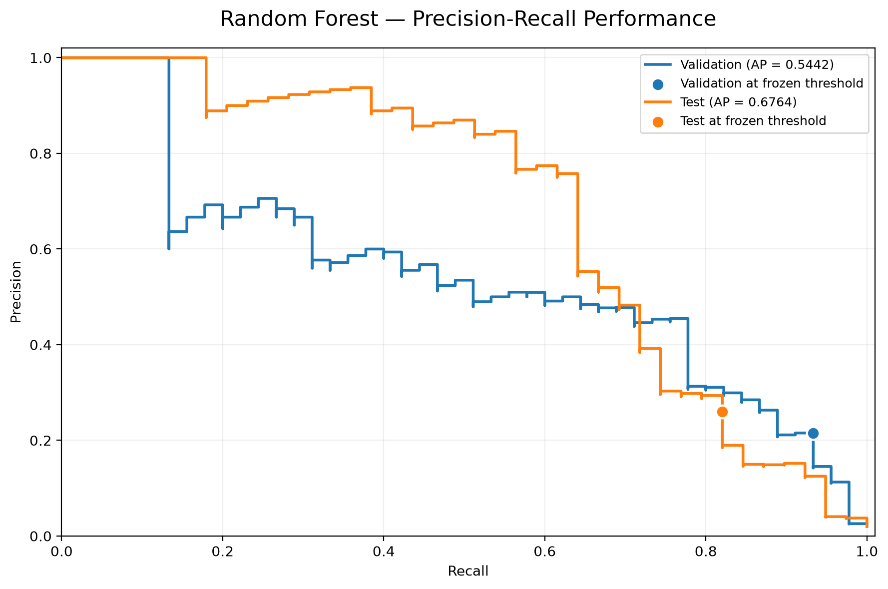
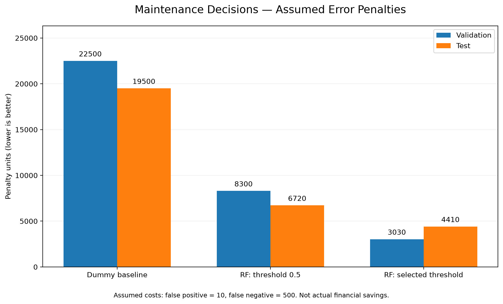
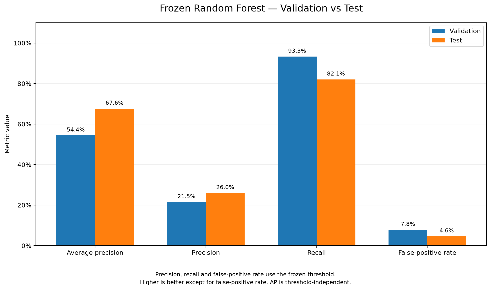
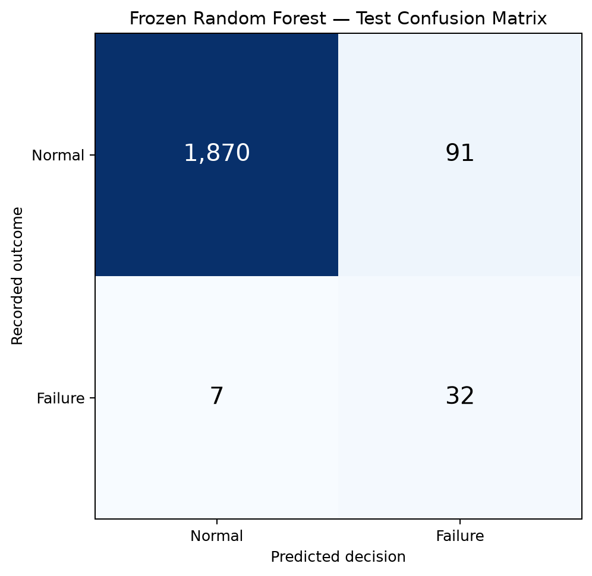

# Maintenance Decision Service

**Cost-sensitive machine learning for equipment failure classification and maintenance review decisions.**


A machine learning model can identify potential equipment failures, but a useful decision system also needs to account for the consequences of missed failures and unnecessary maintenance reviews.

This project builds that decision layer around a Random Forest classifier using the AI4I 2020 Predictive Maintenance dataset. It covers data validation, model comparison, cost-sensitive threshold selection, frozen-model evaluation, a FastAPI prediction service, automated tests and reproducibility checks.

**The goal is not just to predict failures, but to turn model scores into testable maintenance review decisions.**

## Results at a glance

The final Random Forest and decision threshold were selected using validation data, frozen, and then evaluated on a separate holdout set.

| Metric | Final test result |
|---|---:|
| Test observations | 2,000 |
| Recorded failures | 39 |
| Average precision | 0.6764 |
| Failure recall | **82.05%** |
| Precision | 26.02% |
| False-positive rate | 4.64% |
| Failures detected | 32 of 39 |
| Missed failures | 7 |
| Frozen decision threshold | 0.283622 |

Under the project's assumed error costs, the selected threshold produced a **34.4% lower test penalty** than the default 0.5 threshold.

This improvement came with more false alarms. The cost reduction is measured in assumed penalty units, **not actual financial savings**.

### Decision-policy comparison

| Policy | False positives | Missed failures | Penalty units |
|---|---:|---:|---:|
| Dummy baseline | 0 | 39 | 19,500 |
| Random Forest, threshold 0.5 | 22 | 13 | 6,720 |
| **Random Forest, selected threshold** | **91** | **7** | **4,410** |

The decision policy assumes:

- False positive: 10 penalty units
- False negative: 500 penalty units

This deliberately places a higher cost on missing a failure than on requesting an unnecessary review.

The selected policy reduces missed failures from 13 to 7 relative to the default threshold, while increasing false positives from 22 to 91.

These are experimental assumptions. Real maintenance costs and operational capacity would need to be established before deployment.

## Evaluation

### 1. Precision-recall performance



The model was evaluated using average precision because equipment failures are relatively rare.

Validation average precision was 0.5442, compared with 0.6764 on the holdout set. The same frozen model was used in both evaluations. The difference should not be interpreted as an improvement from additional training.

The plotted operating points show precision and recall at the validation-selected threshold.

### 2. Decision-cost comparison



The cost-sensitive threshold was chosen using validation data only.

On the holdout set, the selected policy incurred 4,410 assumed penalty units versus 6,720 at the default 0.5 threshold.

The lower penalty reflects the chosen cost assumptions and the trade-off between false alarms and missed failures.

### 3. Validation versus test performance



| Metric | Validation | Test |
|---|---:|---:|
| Average precision | 0.5442 | 0.6764 |
| Precision | 21.54% | 26.02% |
| Recall | 93.33% | 82.05% |
| False-positive rate | 7.83% | 4.64% |

The holdout recall was lower than validation recall. This is important because the test set contained only 39 failures, so individual classification errors have a noticeable impact on the reported metrics.

### 4. Holdout confusion matrix



At the selected threshold:

- True negatives: 1,870
- False positives: 91
- False negatives: 7
- True positives: 32

The full evaluation methodology, error analysis and limitations are documented in the [model card](docs/model_card.md).

## The problem

Equipment failure is an imbalanced classification problem. A model can achieve high overall accuracy by predicting that most machines will not fail, while still missing important failure cases.

A standard decision threshold of 0.5 is not necessarily appropriate when false negatives and false positives have different operational consequences.

This project separates two decisions:

1. **Predictive modelling:** Generate a score representing the model's assessment of a failure case.
2. **Decision policy:** Convert that score into a `normal` or `review` action using a frozen threshold informed by assumed error costs.

The result is a small, reproducible ML decision service rather than a standalone training notebook.

## System design

```text
UCI AI4I 2020 dataset
        |
        v
Download + SHA-256 verification
        |
        v
Data and feature validation
        |
        v
Fixed train / validation / test blocks
        |
        v
Model comparison
Dummy | Logistic Regression | Random Forest
        |
        v
Validation-only threshold selection
        |
        v
Frozen model + decision configuration
        |
        +------> Final holdout evaluation
        |              |
        |              v
        |       Metrics, error analysis,
        |       confusion matrix and plots
        |
        v
FastAPI prediction service
        |
        v
Model score + normal/review decision
```

### Technology

- **Python:** data processing, modelling and application code
- **Pandas / NumPy:** data validation and feature preparation
- **Scikit-learn:** classification pipelines and evaluation
- **FastAPI / Pydantic:** typed prediction API and input validation
- **Pytest:** automated verification
- **Matplotlib:** evaluation charts
- **GitHub Actions:** automated model rebuilding, checksum checks and testing

## Dataset and experimental design

The project uses the [AI4I 2020 Predictive Maintenance Dataset](https://archive.ics.uci.edu/dataset/601/ai4i+2020+predictive+maintenance+dataset) from the UCI Machine Learning Repository.

The dataset contains 10,000 synthetic observations, including 339 recorded machine-failure cases.

### Model inputs

Only six features are used:

| Feature | Description |
|---|---|
| `Type` | Product quality/type category |
| `Air temperature [K]` | Air temperature |
| `Process temperature [K]` | Process temperature |
| `Rotational speed [rpm]` | Rotational speed |
| `Torque [Nm]` | Torque |
| `Tool wear [min]` | Tool wear |

The target is `Machine failure`.

Identifiers and failure-mode indicators are excluded from model inputs to avoid inappropriate leakage. These include `UDI`, `Product ID`, `TWF`, `HDF`, `PWF`, `OSF` and `RNF`.

### Data split

| Split | Observations | Failures |
|---|---:|---:|
| Training | 6,000 | 255 |
| Validation | 2,000 | 45 |
| Test | 2,000 | 39 |

The split uses fixed blocks in the dataset's original row order. **These blocks are not assumed to represent chronological production data.**

The training block is used to fit models, the validation block to compare models and select the threshold, and the test block for final evaluation.

No threshold tuning is performed on the test block.

## Model selection and decision policy

Three baselines were evaluated:

| Model | Validation average precision |
|---|---:|
| Dummy classifier | 0.0225 |
| Logistic Regression | 0.4161 |
| Random Forest | **0.5442** |

The Random Forest was selected for the decision experiment.

Using the assumed penalties of 10 for a false positive and 500 for a false negative, validation-based threshold selection produced:

```text
Selected model:       Random Forest
Frozen threshold:     0.2836220952642361
Validation penalty:   3,030 units
Decision rule:        review if score >= threshold
```

The model, threshold, feature list, dataset checksum and model-file checksum are recorded in [`configs/decision.yaml`](configs/decision.yaml).

The frozen model is verified before use by the prediction service.

## Prediction API

The project exposes a local FastAPI service with three endpoints:

| Endpoint | Method | Purpose |
|---|---|---|
| `/health` | GET | Service health and model availability |
| `/model-info` | GET | Frozen model and decision-policy information |
| `/predict` | POST | Score equipment features and return a review decision |

The prediction endpoint validates its input against the expected feature schema. Unsupported fields and invalid inputs are rejected.

### Start the service

After completing the installation and model preparation instructions below:

```bash
python -m uvicorn maintain.api:app --host 127.0.0.1 --port 8000
```

Open the interactive API documentation:

**http://127.0.0.1:8000/docs**

To try a prediction:

1. Expand `POST /predict`.
2. Select **Try it out**.
3. Use the documented request schema to enter an equipment observation.
4. Select **Execute**.
5. Inspect the returned model score, frozen threshold and `normal` or `review` decision.

You can also check the service using:

```bash
curl http://127.0.0.1:8000/health
curl http://127.0.0.1:8000/model-info
```

The service uses the frozen Random Forest and the same decision threshold used during offline evaluation.

The returned score is a model output, **not a guaranteed calibrated probability of real-world failure**.

## Installation and local setup

The reference environment uses **Python 3.14.7 on macOS ARM64**, with dependency versions recorded in `requirements-py314.txt`.

The strict model checksum has been reproduced successfully in that environment. Other operating systems may produce a different serialized model or slightly different predictions.

### 1. Clone the repository

```bash
git clone https://github.com/databyaryan-commits/maintenance-decision-service.git
cd maintenance-decision-service
```

### 2. Create a virtual environment

Make Python 3.14.7 available on your machine, then create and activate a virtual environment:

```bash
python3.14 -m venv .venv
source .venv/bin/activate
```

Confirm the interpreter version:

```bash
python --version
```

### 3. Install dependencies

```bash
python -m pip install -r requirements-py314.txt
python -m pip install --no-deps -e .
python -m pip check
```

### 4. Download and verify the dataset

```bash
python -m maintain.download_data
```

This downloads the original AI4I dataset from UCI and verifies its SHA-256 checksum and basic structure.

If the expected dataset already exists, the command verifies the existing file without replacing it.

### 5. Recreate the splits and train the models

```bash
python -m maintain.splits
python -m maintain.train
```

The training command fits the original baseline models and saves the model files locally.

### 6. Verify the frozen model

```bash
python -m maintain.frozen
```

This checks that the regenerated Random Forest matches the frozen configuration, including its SHA-256 checksum.

### 7. Run the tests and API parity check

```bash
python -m pytest -q
python -m maintain.check_parity
```

The project currently contains **80 automated tests**.

The parity check compares direct model predictions against FastAPI predictions to ensure they produce matching scores and review decisions.

## One-command reproduction

After installing the recorded dependencies, the model reproduction workflow can also be run with:

```bash
python -m maintain.reproduce
```

This command:

1. Creates a temporary workspace using Git-tracked project files.
2. Downloads and verifies the original dataset.
3. Recreates the data splits.
4. Retrains the original models.
5. Checks the Random Forest against the frozen configuration.
6. Verifies API/model prediction parity.
7. Runs the automated test suite.
8. Cleans up the temporary workspace.

The command does **not** overwrite the original repository's trained models or saved experiment results.

It verifies the experiment in a temporary workspace; it does not install the reproduced model into the working repository for use by the local API.

## Continuous integration and reproducibility

GitHub Actions runs the project's CI workflow on pushes and pull requests to `main`.

The workflow uses a macOS ARM64 runner and the recorded Python dependency environment. It:

- Downloads and verifies the dataset.
- Rebuilds the original models.
- Enforces the frozen Random Forest checksum.
- Runs the complete automated test suite.
- Checks FastAPI and direct-model prediction parity.

**Verified result:** The original model file and all 2,000 validation prediction scores reproduced exactly on the tested GitHub macOS ARM64 runner. All 80 tests passed.

### Cross-platform limitation

A separate Linux reproduction experiment did not produce an identical Random Forest model.

On Linux:

- The model checksum differed.
- The maximum validation-score difference was approximately 0.00657.
- Two validation review decisions changed.
- Validation recall decreased from 93.33% to 91.11%.
- Assumed validation penalty increased from 3,030 to 3,520 units.

The frozen model and saved evaluation results have not been changed to accommodate this difference.

**Exact reproducibility is therefore established for the tested macOS ARM64 environment, not universally across operating systems.**

## Repository structure

```text
maintenance-decision-service/
├── .github/workflows/
│   └── ci.yml
├── artifacts/example/
│   ├── baseline_metrics.csv
│   ├── validation_predictions.csv
│   ├── validation_decisions.csv
│   ├── holdout_metrics.csv
│   ├── holdout_predictions.csv
│   ├── error_examples.csv
│   └── evaluation charts and supporting results
├── configs/
│   └── decision.yaml
├── data/
│   └── README.md
├── docs/
│   └── model_card.md
├── src/maintain/
│   ├── api.py
│   ├── data.py
│   ├── download_data.py
│   ├── splits.py
│   ├── features.py
│   ├── train.py
│   ├── evaluate.py
│   ├── sensitivity.py
│   ├── freeze.py
│   ├── frozen.py
│   ├── holdout.py
│   ├── error_analysis.py
│   ├── check_parity.py
│   ├── reproduce.py
│   └── plotting modules
├── tests/
├── pyproject.toml
├── requirements-py314.txt
└── README.md
```

Raw datasets, generated model binaries and virtual environments are excluded from Git.

## Limitations and intended use

This is an engineering and machine learning portfolio project, not a production-validated maintenance system.

Important limitations include:

- **Synthetic data:** The dataset does not establish performance on an actual industrial fleet.
- **Small failure sample:** The final test set contains only 39 failure cases.
- **Non-chronological split:** The evaluation does not demonstrate future-time forecasting performance.
- **Assumed decision costs:** The penalty values are hypothetical rather than measured operational costs.
- **Uncalibrated scores:** Model outputs should not be interpreted as guaranteed real-world failure probabilities.
- **Review capacity:** The selected threshold increases false alarms, which could create operational workload.
- **Cross-platform differences:** Exact model reproduction has only been established in the tested macOS ARM64 environment.

The model should not be used to make real maintenance or safety decisions without additional validation, calibration, operational testing and domain review.

For further details, see the [model card](docs/model_card.md), [dataset documentation](data/README.md) and [frozen decision configuration](configs/decision.yaml).

## License and data source

Project licensing information is available in [LICENSE](LICENSE).

Dataset: AI4I 2020 Predictive Maintenance Dataset, UCI Machine Learning Repository. See the [UCI dataset page](https://archive.ics.uci.edu/dataset/601/ai4i+2020+predictive+maintenance+dataset) for source information and licensing.
